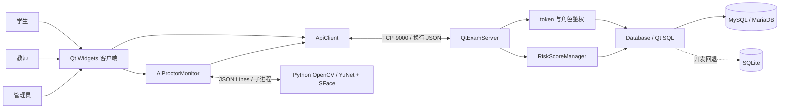
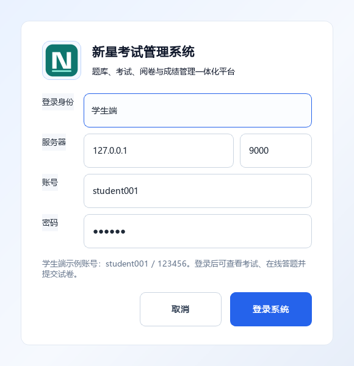
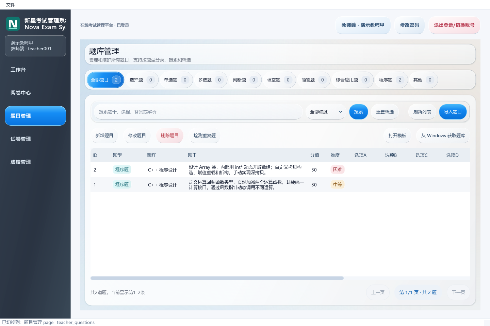

# 新星考试管理系统 · NovaExamSystem

**面向国产 Linux 桌面适配的 C++ / Qt 在线考试与多教师阅卷平台。**

[English](README_EN.md) · [编译部署](docs/BUILD.md) · [实现与协议](docs/ARCHITECTURE.md) · [验证记录](docs/VERIFICATION.md) · [安全边界](SECURITY.md)

`C++17` · `Qt Widgets` · `TCP / JSON` · `MySQL / SQLite` · `OpenCV`

> 毕业设计 / 个人工程作品集。项目所有者已确认公开，自有代码采用 MIT License；不是生产级考试安全产品。所有功能说明来自源码，未实测部分见验证记录。

## 项目背景

围绕考试管理中的「账号 → 题库 → 组卷发布 → 在线答题 → 多教师阅卷 → 成绩与风险记录」闭环，构建独立桌面客户端和数据库服务端，并保留麒麟/Linux 部署入口。项目关注角色权限、跨进程图像处理、答卷锁定和跨平台工程适配，而非单页界面演示。

## 核心能力

| 模块 | 代码实现 | 主要入口 |
|---|---|---|
| 三角色登录与账号管理 | 学生/教师/管理员；服务端 token 与角色鉴权，账号维护、密码修改/重置 | `logindialog.cpp` / `ExamServer::requireRole` |
| 题库与组卷 | 题目维护、分类筛选、CSV/XLSX 导入、试卷创建/发布/关闭 | `excelimporter.cpp` / `mainwindow.cpp` |
| 在线答题 | 考试列表、倒计时、草稿与提交、个人考试记录 | `MainWindow` / `Database::submitExam` |
| 多教师阅卷 | 领取答卷、锁定/释放、逐题给分与评语、成绩汇总 | `Database` / `ExamServer` |
| 监考与风险 | 人脸采集、核验、无人脸/多人脸/不匹配、切屏/全屏退出等事件记录及累计评分 | `AiProctorMonitor` / `RiskScoreManager` |
| 跨平台部署 | Windows Qt 客户端、Linux PIE/RPATH 设置、麒麟脚本、Ubuntu systemd 服务模板 | 两个 `CMakeLists.txt` / `deploy/` |

上述为源码已实现能力，不代表每项均已完成端到端验收。面试时可重点讲解协议切帧、权限校验、数据库状态流转及跨平台摄像头桥接。

## 技术栈与架构

客户端：Qt6 Widgets、Network、Xml、Multimedia，C++17、CMake。服务端：Qt Core / Network / Sql，优先 Qt6，同时提供 Qt5/C++11 构建分支。存储默认 MySQL/MariaDB，SQLite 为显式开发回退。人脸模块通过 Python/OpenCV、NumPy 完成本地推理；没有大模型或生成式 AI 阅卷。



### 通信机制

客户端每次请求建立 TCP 短连接，发送 UTF-8 JSON 并以换行结束；服务端按换行缓存切帧。登录成功得到内存会话 token，后续请求自动附带 token，服务端按角色验证操作权限。响应使用 `type`、`success` 和业务字段/`error`；不是 HTTP REST 或 WebSocket。当前没有 TLS，必须限定在受控网络。

### 数据库设计

`users` 存账号角色；`questions`、`exams`、`exam_questions` 关联题目和试卷；`exam_publish_records` 记录发布；`submissions`、`submission_answers` 保存答卷、评分和阅卷锁；`user_face_profiles` 存特征模板；`exam_abnormal_logs`、`system_logs` 存事件记录。字段和迁移以服务端 `src/database.cpp` 为准，启动时自动建表，**不是导入真实数据库备份**。

### 防作弊与人脸模块

Qt 摄像头采集与 Python 子进程协作，YuNet 检测人脸、SFace 比较特征，另有 Haar 回退和显式模拟演示路径。服务端按异常类型累计风险分，同类事件设置冷却期；风险等级按 30/60/90 分边界分级。模拟模式及网络异常只留痕，不加作弊分。

风险分是提示性规则，不是作弊结论；客户端事件可被篡改，模拟路径不能当作真实核验，Haar 回退不能宣称与 SFace 等价。未提供准确率、吞吐量或并发容量指标。

## 真实界面

以下截图由发布版真实 Qt 窗口在 Windows 的 offscreen 平台自动运行捕获，使用新建 SQLite 演示库和原创几何图标；未重绘、拼接或修改界面像素。它们是自动渲染检查，不等同于完整人工 UI 验收。旧截图因包含来源未确认的旧 Logo 而排除。详见 [截图说明](screenshots/README.md)。

### 登录界面


### 题库管理


## 快速开始

完整操作见 [BUILD.md](docs/BUILD.md)。在仓库根目录执行；建议放到纯英文目录，避免部分 Windows Qt `moc` 对中文路径的兼容问题。

### Windows

安装匹配的 Qt6 MinGW 64-bit Kit、CMake 和 Ninja，优先用 Qt Creator 分别打开两个子项目的 `CMakeLists.txt`。Qt 6.5.3 是目标环境之一，但不能把它写成本轮已验证版本。

在对应 Qt Kit 命令行（工具已加入 PATH）执行，`QT_ROOT` 指向自己的 Kit：

```powershell
$env:QT_ROOT = Read-Host 'Qt MinGW Kit 路径'
cmake -S QtExamServer -B build-server -G Ninja "-DCMAKE_PREFIX_PATH=$env:QT_ROOT" -DCMAKE_BUILD_TYPE=Release
cmake --build build-server --parallel 2
cmake -S QtExamSystem -B build-client -G Ninja "-DCMAKE_PREFIX_PATH=$env:QT_ROOT" -DCMAKE_BUILD_TYPE=Release
cmake --build build-client --parallel 2
Copy-Item config/client_config.example.ini build-client/client_config.ini
.\build-server\QtExamServer.exe --host 127.0.0.1 --port 9000 --db-driver sqlite --db ./build-server/demo.db
```

另开同一工具链终端运行 `./build-client/QtExamSystem.exe`。Windows 服务端需将 Qt/MinGW DLL 加入 PATH 或执行 `windeployqt`；MySQL 还需要匹配版本的 QMYSQL 插件与客户端库，Qt 安装包不一定自带。

### Linux / Ubuntu / 麒麟

以下是 apt 系 Qt6 环境的手动构建路径，目标发行版需提供相应包；不是所有国产发行版通用安装器：

```bash
sudo apt update
sudo apt install build-essential cmake ninja-build qt6-base-dev qt6-multimedia-dev libqt6sql6-mysql
cmake -S QtExamServer -B build-server -G Ninja -DCMAKE_BUILD_TYPE=Release
cmake --build build-server --parallel 2
cmake -S QtExamSystem -B build-client -G Ninja -DCMAKE_BUILD_TYPE=Release
cmake --build build-client --parallel 2
cp config/client_config.example.ini build-client/client_config.ini
./build-server/QtExamServer --host 127.0.0.1 --port 9000 --db-driver sqlite --db ./build-server/demo.db
```

另开终端执行 `./build-client/QtExamSystem`。麒麟专用入口为 `QtExamSystem/deploy/kylin/`；代码保留 Linux PIE 和 Qt RPATH 处理。现存部署脚本和历史截图说明曾开展适配，本轮未在麒麟/Ubuntu 上重新编译或验证；不宣称信创认证或所有架构兼容。

### MySQL 与服务部署

先启动空数据库，再由服务端建表与生成**演示数据**。推荐在 MySQL 交互终端执行初始化模板，执行前修改占位密码：

```sql
SOURCE QtExamServer/scripts/init_mysql.sql;
```

服务端使用环境变量传密码，而不是命令行参数：

```powershell
$secure = Read-Host 'MySQL 密码' -AsSecureString
$env:QT_EXAM_DB_PASSWORD = [System.Net.NetworkCredential]::new('', $secure).Password
.\build-server\QtExamServer.exe --host 127.0.0.1 --port 9000 --db-driver mysql --mysql-host 127.0.0.1 --mysql-db qt_exam_server --mysql-user qt_exam
```

Linux 使用 `read -rs QT_EXAM_DB_PASSWORD` 后 `export QT_EXAM_DB_PASSWORD`，或使用权限为 `600` 的环境文件。Ubuntu systemd 安装见 [部署文档](docs/BUILD.md#linux-systemd)。保持原端口 9000，不再自动修改网卡或配置固定 IP。

演示账号：`student001 / 123456`、`teacher001 / 123456`、`admin / admin123`。**仅为一次性本地演示，请勿用于真实数据。** 旧库不会被本次初始化自动覆盖；不要把演示脚本对准真实业务库。

## 目录

```text
NovaExamSystem/
├── QtExamSystem/       # 保留原客户端目录与 CMake 配置
│   ├── src/           # Widgets、ApiClient、监考、文件导入
│   ├── resources/     # 原应用图标、Logo、QSS
│   ├── data/          # 演示导入模板
│   ├── tools/         # Python 图像桥接及可选宿主机辅助服务
│   └── deploy/kylin/  # 构建、依赖及启动入口
├── QtExamServer/       # 服务端、数据库访问、风险规则
│   ├── src/
│   ├── scripts/       # 初始化/可选种子 SQL
│   ├── deploy/        # systemd / MySQL 部署模板
│   └── tools/         # 仅面向一次性数据库的冒烟脚本
├── config/            # 无真实凭据的配置模板
├── docs/              # 架构、构建、审计及验证
└── screenshots/       # 筛选过的真实历史运行截图
```

## 已知限制与优化方向

- 当前明文协议、固定前缀密码哈希、弱演示账号不满足生产安全要求；后续引入 TLS、慢哈希及会话过期机制。
- 部分网络调用同步等待，主窗口较大；可逐步拆分视图与业务层、异步化请求，不应为发布而大规模重构。
- 摄像头和 ONNX 兼容性受系统、设备、OpenCV 版本影响；模型需另行获取，真实推理本轮未测。
- Windows 宿主机桥接仅为可选实验功能，无完善鉴权，不应公网部署；Linux 主按钮有依赖宿主机的路径，独立运行可用文件菜单本地导入入口。
- 数据库约束、并发锁边界、断线恢复及权限负向用例仍需持续补测，无性能或稳定性承诺。
- 发布版截图使用演示数据与原创替换图标；不代表已完成全部界面功能验收，原始项目未修改。
- 优先补全跨平台 CI、迁移测试、可配置演示种子、隐私数据保留策略和第三方素材授权记录。

## 许可与发布状态

自有代码与本次原创替换图形采用 [MIT License](LICENSE)，Copyright (c) 2026 uuufdfd。项目所有者于 2026-11-25 明确同意公开，并确认不存在其已知的学校额外公开限制。第三方依赖保留各自许可证，不受本项目 MIT 重新授权；见 [THIRD_PARTY_NOTICES.md](THIRD_PARTY_NOTICES.md)。来源未确认的旧图标、Logo 与含旧 Logo 截图已排除；公开历史为经授权清理的发布快照，不伪造过去的开发记录。
