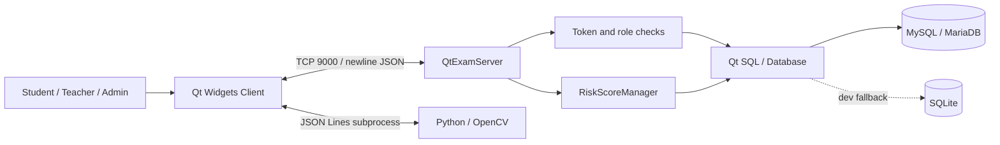
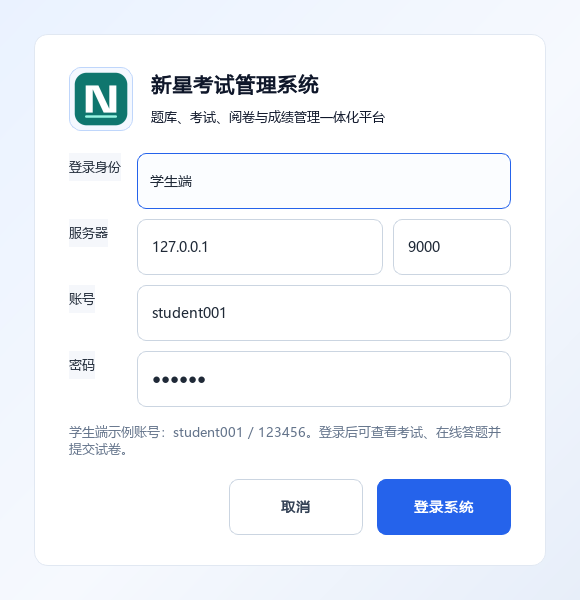
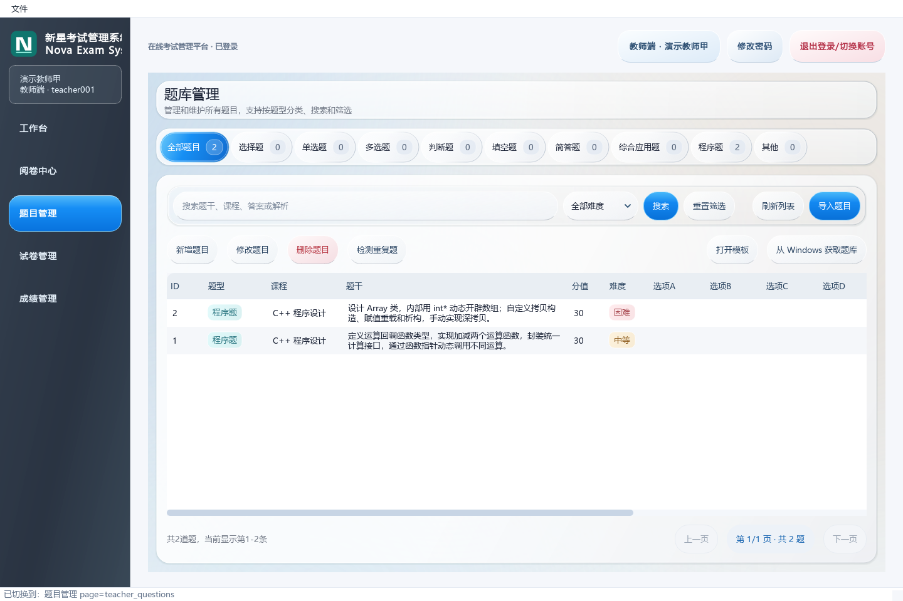

# NovaExamSystem

**A C++ / Qt desktop examination and multi-teacher grading platform, with deployment work targeting Kylin Linux.**

[简体中文](README.md) · [Build & deployment](docs/BUILD.md) · [Implementation](docs/ARCHITECTURE.md) · [Verification](docs/VERIFICATION.md)

> Graduation project and engineering portfolio. The owner has authorized publication and licensed the original code under MIT. This is not a production-ready examination product; documented security limitations and unverified platforms remain unchanged.

## Background and features

The application connects account administration, question management, exam publication, student submissions, teacher grading and risk review in a desktop client-server workflow.

- Student, teacher and administrator interfaces, backed by server-side token/role checks.
- Question CRUD, CSV/XLSX import, exam creation, publication and closure.
- Exam countdown, draft saving, submission and personal records.
- Grading assignment through submission locks, per-question marks and comments.
- Camera capture and a Python/OpenCV bridge for YuNet detection and SFace feature comparison, with fallback and explicit simulation paths.
- Client-side abnormal events and server-side cumulative risk scoring with cooldowns.

These capabilities are grounded in source code, not a claim that every feature has passed end-to-end testing. There is no generative-AI grading, measured recognition accuracy, throughput benchmark or certification claim.

## Stack and architecture

Client: C++17, Qt6 Widgets / Network / Xml / Multimedia, CMake. Server: Qt Core / Network / Sql, with Qt6 and Qt5 build branches. MySQL/MariaDB is the default database; SQLite is an explicit development fallback. Python, OpenCV and NumPy support local image processing.



`ApiClient` opens a short-lived TCP connection per request. UTF-8 JSON objects are newline-delimited; the server buffers and splits frames. Login returns an in-memory session token used for subsequent requests. This is not HTTP, REST or WebSocket, and transport is not encrypted.

## Database and proctoring

Core tables cover users, questions, exams and exam-question links, publication records, submissions and answers, face profiles, abnormal-event logs and system logs. Schema creation/migration and demo seeding are implemented in `QtExamServer/src/database.cpp`. No real database dump is distributed.

Face detection/comparison runs through a Python subprocess. The client reports missing/multiple/mismatched faces, screen switching and related events. Server rules accumulate risk with per-event cooldowns; thresholds are 30/60/90. Simulation and network-failure events are recorded without adding cheating points. Risk is an advisory signal, not a reliable misconduct verdict. Haar fallback is not equivalent to SFace; real camera inference was not retested in this release.

## Actual screenshots

Captured from actual release-version Qt windows using the Windows offscreen platform, a fresh synthetic SQLite database and the new original geometric mark. No generated UI images, compositing or pixel edits were used. These are automated render checks, not full manual UI acceptance tests. Old screenshots containing artwork of unconfirmed provenance were excluded. See [screenshot provenance](screenshots/README.md).




## Build and run

Build the two existing CMake projects separately; do not expect a new root CMake project. Use an ASCII-only checkout path on Windows if Qt `moc` fails on a non-ASCII path. Commands below assume the chosen Qt Kit, compiler, CMake and Ninja are available on PATH.

### Windows / PowerShell

```powershell
$env:QT_ROOT = Read-Host 'Path to your Qt MinGW Kit'
cmake -S QtExamServer -B build-server -G Ninja "-DCMAKE_PREFIX_PATH=$env:QT_ROOT" -DCMAKE_BUILD_TYPE=Release
cmake --build build-server --parallel 2
cmake -S QtExamSystem -B build-client -G Ninja "-DCMAKE_PREFIX_PATH=$env:QT_ROOT" -DCMAKE_BUILD_TYPE=Release
cmake --build build-client --parallel 2
Copy-Item config/client_config.example.ini build-client/client_config.ini
.\build-server\QtExamServer.exe --host 127.0.0.1 --port 9000 --db-driver sqlite --db ./build-server/demo.db
```

Start `./build-client/QtExamSystem.exe` in another Kit terminal. The server requires Qt/MinGW DLLs on PATH or deployment with `windeployqt`. MySQL requires an ABI-compatible QMYSQL driver and client library; these may not ship with the installed Qt Kit. Qt 6.5.3 remains a target, not a version verified in this release.

### Linux / Ubuntu / Kylin

For apt-based systems providing Qt6 packages:

```bash
sudo apt update
sudo apt install build-essential cmake ninja-build qt6-base-dev qt6-multimedia-dev libqt6sql6-mysql
cmake -S QtExamServer -B build-server -G Ninja -DCMAKE_BUILD_TYPE=Release
cmake --build build-server --parallel 2
cmake -S QtExamSystem -B build-client -G Ninja -DCMAKE_BUILD_TYPE=Release
cmake --build build-client --parallel 2
cp config/client_config.example.ini build-client/client_config.ini
./build-server/QtExamServer --host 127.0.0.1 --port 9000 --db-driver sqlite --db ./build-server/demo.db
```

Run `./build-client/QtExamSystem` in another terminal. Kylin helpers are under `QtExamSystem/deploy/kylin/`; Linux PIE/RPATH handling is retained. Existing scripts and historical artifacts show prior adaptation work, but no Linux/Kylin rebuild, ARM validation or distribution certification was performed in this release.

### MySQL and deployment

Edit the placeholder password in `QtExamServer/scripts/init_mysql.sql`, then run it using the MySQL client's `SOURCE` command. It creates the database and database users; the application creates tables and demo seeds on first startup. `seed_mysql.sql` is optional and requires existing tables.

Pass the actual password through `QT_EXAM_DB_PASSWORD`, not process arguments. Configure host/database/user using the server CLI. `config/server.example.env` is a template, not automatically loaded by the standalone binary. Linux systemd installation and environment-file handling are documented in [BUILD.md](docs/BUILD.md#linux-systemd).

Demo credentials: `student001 / 123456`, `teacher001 / 123456`, `admin / admin123`. These are public test fixtures, not production credentials. Never run initialization or smoke tests against an existing real database.

## Layout

```text
QtExamSystem/     Existing client, resources, import templates, runtime helpers, Kylin scripts
QtExamServer/     Existing server, SQL initialization, deployment and smoke-test helpers
config/          Credential-free configuration templates
docs/            Architecture, build, audit and verification notes
screenshots/     Selected original runtime screenshots
scripts/         Optional isolated test harness
```

## Limitations and roadmap

Plaintext transport, fixed-prefix SHA-256 password hashes, demo passwords, in-memory sessions without complete expiry/revocation and unauthenticated host HTTP bridges limit this project to controlled demonstrations. Client-generated risk events can be manipulated. The offline account component can persist plaintext data. Read [SECURITY.md](SECURITY.md).

The large main-window implementation and synchronous network requests remain refactoring opportunities. Model compatibility is environment-dependent and weights are not bundled. Some Linux import buttons expect an optional Windows host bridge; local import remains available through the file menu. Further work should prioritize TLS, slow password hashing, session lifecycle, asynchronous networking, cross-platform CI, migration/concurrency tests and biometric-data retention policy.

## License

Original code and the newly created geometric branding are licensed under the [MIT License](LICENSE), Copyright (c) 2026 uuufdfd. On 2026-11-25 the owner explicitly authorized public release and confirmed no known additional school restrictions. Third-party dependencies retain their own licenses and are not relicensed under MIT; see [THIRD_PARTY_NOTICES.md](THIRD_PARTY_NOTICES.md). Old artwork and screenshots containing it were excluded. Public history is an owner-authorized sanitized release snapshot, not fabricated historical development activity.
