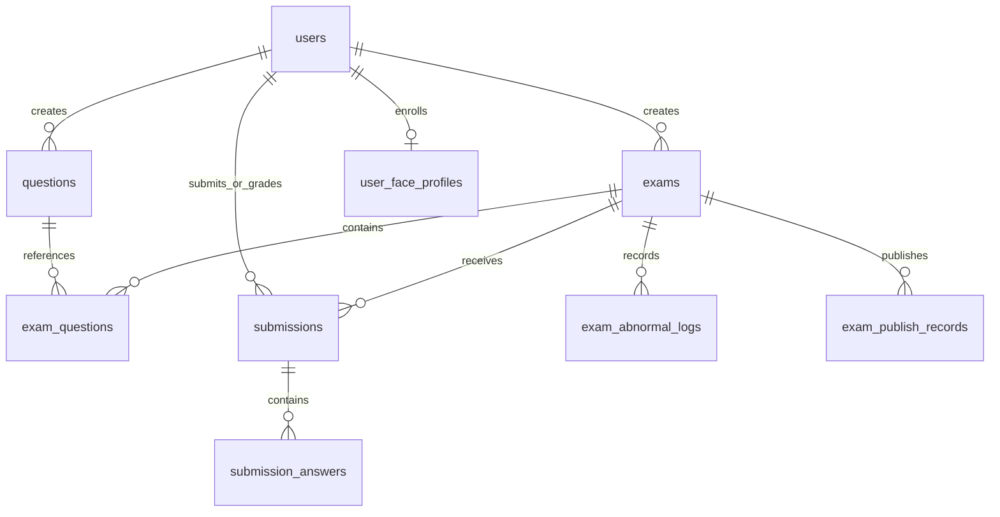

# 实现索引与协议

## 源码导航

| 文件 | 职责 |
|---|---|
| QtExamSystem/src/main.cpp | 字体/资源加载、登录与主窗口循环 |
| QtExamSystem/src/logindialog.cpp | 角色选择、在线登录与服务器地址 |
| QtExamSystem/src/apiclient.cpp | QTcpSocket 短连接、换行 JSON、token 自动携带 |
| QtExamSystem/src/mainwindow.cpp | 三角色视图、题库、组卷、答题、阅卷、成绩/风险界面 |
| QtExamSystem/src/excelimporter.cpp | CSV/XLSX 等导入解析 |
| QtExamSystem/src/aiproctormonitor.cpp | 摄像头/进程桥接、特征比对与异常事件 |
| QtExamSystem/tools/face_recognition_bridge.py | stdin/stdout JSON Lines 推理桥接 |
| QtExamServer/src/main.cpp | CLI 参数、数据库驱动选择、环境变量密码 |
| QtExamServer/src/examserver.cpp | TCP 接收缓存、请求分发、角色鉴权 |
| QtExamServer/src/database.cpp | DDL/迁移、SQL、事务、示例种子、阅卷锁 |
| QtExamServer/src/riskscoremanager.cpp | 冷却去重、累计评分、风险等级 |

## 请求/响应

每个 JSON 对象后必须跟 `\n`。先用 `ping` 或 `login`，成功后请求携带 `token`。

```json
{"type":"login","username":"teacher001","password":"123456","role":"teacher"}
```

成功响应包含 `success: true`、`token`、`user`；失败响应包含 `success: false`、`error`。
具体字段以各 `handle*` 方法及客户端调用点为准。请求族包括：

- `list_users` / `create_user` / `update_user` / `delete_user` / `reset_password`
- `list_questions` / `import_questions` / `create_question` / `update_question`
- `create_exam` / `publish_exam` / `close_exam` / `list_exams` / `get_exam_detail`
- `save_draft` / `submit_exam` / `list_my_submissions`
- `lock_submission` / `release_submission` / `submit_grade`
- `save_face_profile` / `get_my_face_profile`
- `record_abnormal_event` / `list_risk_records` / `list_risk_logs`

角色权限并非只隐藏按钮：服务端 `requireRole` 验证 token，并在处理函数/数据库层检查资源访问。并不代表做过完整渗透测试或所有越权场景均无缺陷。

## 数据关系



阅卷锁采用数据库字段与状态更新，不是分布式锁服务。发布记录去重、索引和兼容迁移在 `database.cpp` 初始化流程内。不要同时把手工迁移和新库初始化当成必需步骤重复执行。
